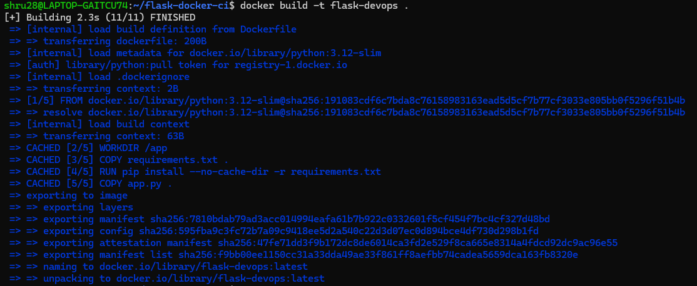
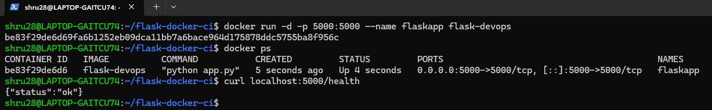
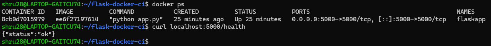
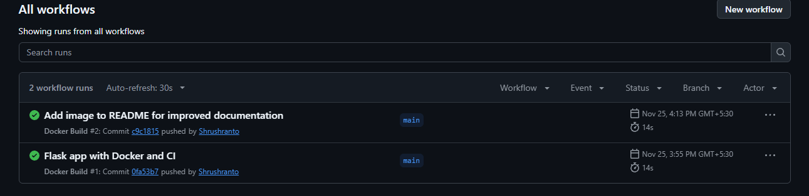
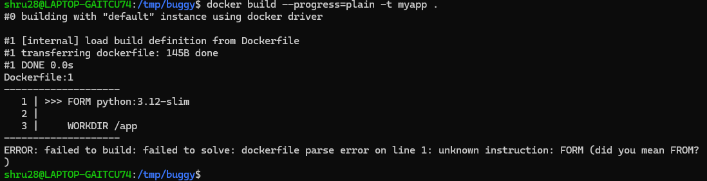
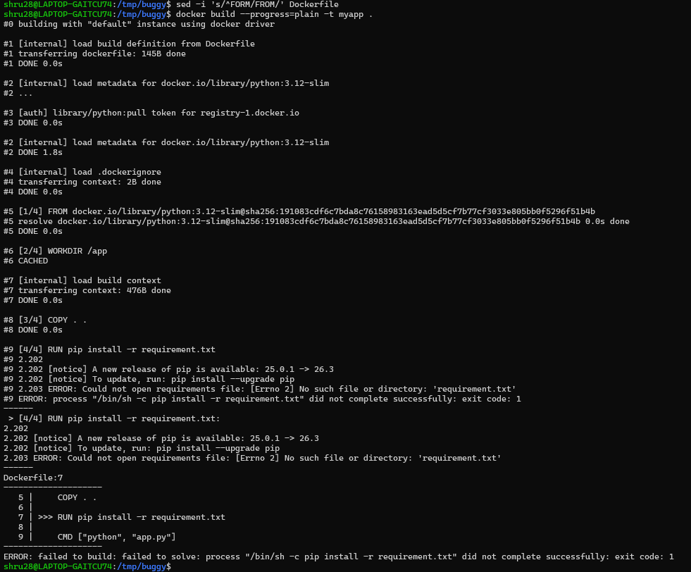
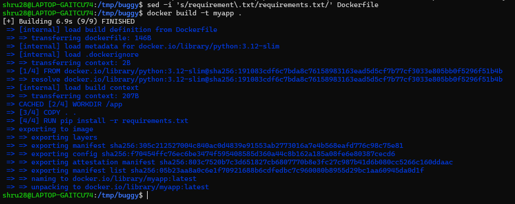
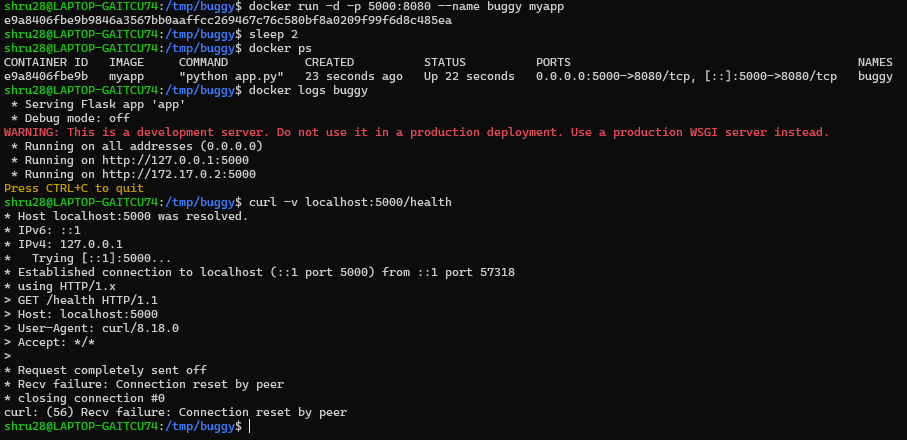
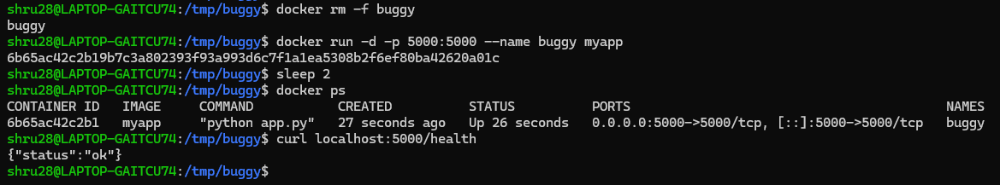

# Flask Docker CI

A small Flask app, dockerized, with a GitHub Actions workflow that builds the Docker image on every push.

## Project files
- `app.py` - Flask app with `/` and `/health` routes
- `requirements.txt` - Python dependencies (`flask`)
- `Dockerfile` - builds the container image
- `.github/workflows/build.yml` - CI workflow
- `screenshots/` - screenshots referenced in this README

## Build and run
```
docker build -t flask-devops .
docker run -d -p 5000:5000 --name flaskapp flask-devops
```

Build:



Run:



## Test
```
curl localhost:5000/
curl localhost:5000/health
```
Output:
```
Hello from DevOps!
{"status":"ok"}
```



## CI
`.github/workflows/build.yml` runs on every push. It checks out the code and builds the Docker image with `docker build -t flask-devops .`. Pushing to a registry is not required.



## Task 4: Bugs found and fixes

The app code (`app.py`, `requirements.txt`) is correct: it binds to `0.0.0.0` on port 5000 and both routes work. The problems were in the teammate's Dockerfile and run command.

| # | Problem | Effect | Fix |
|---|---------|--------|-----|
| 1 | `FORM python:3.12-slim` | Docker rejects the unknown instruction `FORM`, so the build fails | Changed to `FROM` |
| 2 | `RUN pip install -r requirement.txt` | The file is named `requirements.txt`, so pip cannot find it and the build fails | Changed to `requirements.txt` |
| 3 | `docker run -p 5000:8080 myapp` | The app listens on port 5000 inside the container, but host port 5000 is forwarded to container port 8080 where nothing listens, so the app cannot be reached | Changed to `-p 5000:5000` |

### Bug 1: `FORM` instead of `FROM`
Error from `docker build`:



### Bug 2: `requirement.txt` instead of `requirements.txt`
Error from the `pip install` step:



After the fix, the build succeeds:



### Bug 3: wrong port mapping
The container is running (`docker ps` shows `5000->8080`), the Flask logs show the app on port 5000, and `curl` fails with "Connection reset by peer":



### After the fix
With `-p 5000:5000` the app responds:



### Other improvements
- Copy `requirements.txt` and install dependencies before copying the app, so Docker caches the dependency layer.
- Add `EXPOSE 5000` to document the port.

## Result
The image builds successfully, the container runs, and `curl localhost:5000/health` returns `{"status":"ok"}`. The CI workflow builds the image on every push.
